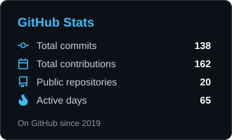
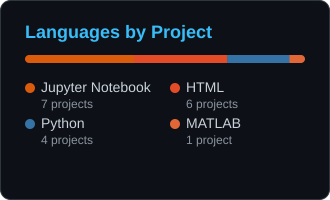

<!-- Header -->
<p align="center">
  
</p>

<p align="center">
  
</p>

<p align="center">
  &nbsp;
  
</p>

---

### 👋 About me

```yaml
name:      Ashu Tayal
based_in:  Chicago, IL
focus:     [data science, machine learning, deep learning, data visualization]
interests: [public policy analytics, predictive modeling, scalable data pipelines]
currently: building things with data — and making them easy to understand
```

### 🛠️ Toolkit

<p>
  
  
  
  
  
  
  
  
  
  
  
  
  
  
  
  
  
  
</p>

### 🚀 Featured projects

<table>
  <tr>
    <td width="50%" valign="top">
      <h4>🦠 <a href="https://github.com/ashutayal/DV_Final">Tracking India's Coronavirus</a></h4>
      <p>Interactive D3.js dashboard of COVID-19 cases across Indian states — choropleth map with cumulative and daily trends.<br/> <a href="https://ashutayal.github.io/DV_Final/"><b>▶ Live demo</b></a></p>
    </td>
    <td width="50%" valign="top">
      <h4>🏛️ <a href="https://github.com/ashutayal/CCSAO-sentencing">Racial Bias in CCSAO Charging</a></h4>
      <p>How race shapes charges and case outcomes in Cook County State's Attorney data (2015–2019), with regression analysis and GeoPandas maps.</p>
    </td>
  </tr>
  <tr>
    <td width="50%" valign="top">
      <h4>🏠 <a href="https://github.com/ashutayal/House-Price-Prediction">House Price Prediction</a></h4>
      <p>Kaggle regression with feature engineering and a stacked XGBoost / LightGBM / scikit-learn ensemble — <b>#283 on the leaderboard</b> (RMSLE 0.1290).</p>
    </td>
    <td width="50%" valign="top">
      <h4>🫁 <a href="https://github.com/ashutayal/UCM_RHA_FAN">Asthma Education Program Evaluation</a></h4>
      <p>Pre/post survey analysis for UChicago Medicine &amp; Respiratory Health Association using paired t-tests and McNemar's test.</p>
    </td>
  </tr>
  <tr>
    <td width="50%" valign="top">
      <h4>🍷 <a href="https://github.com/ashutayal/Advanced-Data-Science-Capstone">Wine Quality Prediction</a></h4>
      <p>IBM Advanced Data Science capstone — logistic regression, random forests and a Keras neural network, plus PySpark ML.</p>
    </td>
    <td width="50%" valign="top">
      <h4>🗺️ <a href="https://github.com/ashutayal/DVHW8">U.S. Vaccination Map</a></h4>
      <p>County-level D3.js choropleth of COVID-19 vaccination rates, recreating a New York Times graphic.<br/> <a href="https://ashutayal.github.io/DVHW8/"><b>▶ Live demo</b></a></p>
    </td>
  </tr>
</table>

### 📈 GitHub stats

<p align="center">
  
  
</p>
<p align="center"><sub>Self-hosted cards, refreshed daily by a GitHub Action.</sub></p>

### 🤝 Let's connect

<p>
  <a href="mailto:ashutayal@hotmail.com"></a>
  <a href="https://www.linkedin.com/in/ashutayal"></a>
  <a href="https://github.com/ashutayal"></a>
</p>


